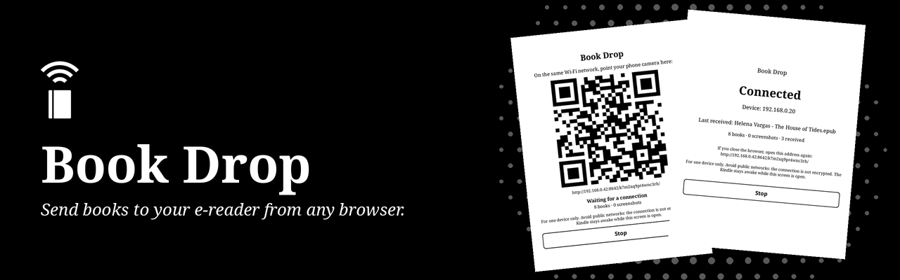
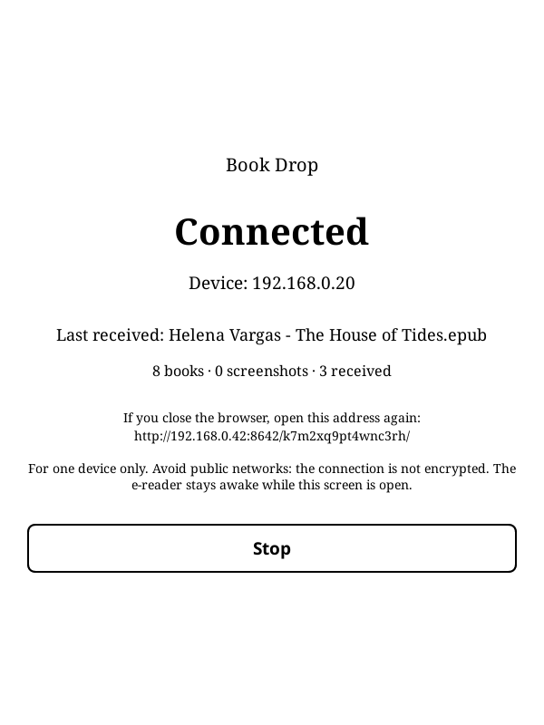

<p align="center">
  
</p>

<p align="center">
  <strong>Send books to KOReader and download books and screenshots from any browser, over your local Wi-Fi.<br>No app to install on the other device.</strong>
</p>

<p align="center">
  <a href="https://github.com/davydmaker/book_drop.koplugin/releases/latest"></a>
  <a href="https://github.com/davydmaker/book_drop.koplugin/actions/workflows/ci.yml"></a>
  <a href="https://github.com/davydmaker/book_drop.koplugin/releases"></a>
  <a href="https://koreader.rocks"></a>
  
  <a href="LICENSE"></a>
  <a href="LICENSE-CONTENT"></a>
</p>

<p align="center">
  <a href="#how-it-works">How it works</a> ·
  <a href="#installation">Installation</a> ·
  <a href="#security">Security</a> ·
  <a href="#compatibility">Compatibility</a> ·
  <a href="#development">Development</a> ·
  <a href="README_pt.md">Leia em português</a>
</p>

## How it works

<table>
  <tr>
    <td width="50%" align="center"><br><sub><b>Point your phone at the code</b></sub></td>
    <td width="50%" align="center"><br><sub><b>See who is connected and what arrived</b></sub></td>
  </tr>
</table>

1. In the Tools menu, open **Book Drop**. The device needs to be on Wi-Fi.
2. On the same network, point your phone camera at the QR code, or type the address in any browser.
3. Tap **Allow** on the e-reader.
4. Use the browser:
   - **Send:** choose one or more books and follow the progress of each one.
   - **Books:** download from your books folder, in a grid with covers or in a list.
   - **Screenshots:** download one by one or all in a `.zip`.
5. Tap **Stop**. Any new book shows up in your library.

The device stays awake while the screen is open, so a transfer is not cut short, and the screen stops by itself after 10 minutes without use.

Accepted formats: EPUB, PDF, MOBI, AZW, AZW3, PRC, FB2, DJVU, CBZ, TXT and RTF, up to 500 MB each. A file with the same name is never replaced.

## Installation

1. Download `book_drop.koplugin.zip` from the [latest release](https://github.com/davydmaker/book_drop.koplugin/releases/latest).
2. Extract it into `koreader/plugins/`, so that `koreader/plugins/book_drop.koplugin/main.lua` exists.
3. Restart KOReader. The plugin is in the Tools menu, as **Book Drop**.

The language follows KOReader's, on the device and in the browser: English, Portuguese or Spanish. In any other language, it uses English.

## Security

> [!WARNING]
> The connection is plain HTTP, because a local server has no certificate to offer. Someone capturing traffic on the same network could see the files. Use your home Wi-Fi or your phone's hotspot, not public networks.

<details>
<summary><b>What protects your device</b></summary>

<br>

- **Only on while in use.** The server exists while the screen is open, and it stops on Stop, on sleep and after 10 minutes without use.
- **A code in the address**, random and new every time. Without it, every answer is the same "not found".
- **Approval on the device.** The first device with the code needs your tap, and after that no other address is served.
- **Private networks only.** It refuses to start outside 10.x, 172.16-31.x and 192.168.x, and refuses clients from outside.
- **Uploads go to one place.** Only book formats, always in your books folder. A name cannot choose a folder or a hidden file, and a file only gets its final name once it arrives complete.
- **Downloads come from a list.** Files are requested by a number in a list made by the server, so there is no path to tamper with. Links are not followed, and KOReader's own data stays out.
- **Books are treated as untrusted.** Covers are read from EPUBs with limits on size and count, and served only when their content really is an image.

The full list is in [docs/design.md](docs/design.md).

</details>

## Compatibility

- Tested with KOReader 2026.07 on a 10th generation basic Kindle (firmware 5.18.1).
- The server and the rules also run on the desktop build of KOReader, where the tests run. Keeping the device awake and opening the firewall are written for Kindle; on other devices, check your own sleep settings and firewall.
- Networks with client isolation, common on guest Wi-Fi, stop the phone from reaching the device.
- Always in portrait. Opened in landscape, it rotates the screen and restores the rotation on exit.

## Development

With [LuaJIT](https://luajit.org) installed, from the repository root:

```sh
for spec in tests/*_spec.lua; do luajit "$spec"; done
```

With `KOREADER_DIR` pointing to a desktop KOReader, `tools/koreader/check_server.sh` starts the real server and tests it with `curl`. Everything is described in [docs/design.md](docs/design.md). Contributions are accepted under the project's licenses.

## License

This project has two licenses. See [NOTICE](NOTICE) for details.

- **Code:** [GPL-3.0](LICENSE), version 3 only. You may use, study, modify and redistribute it, keeping it open under the same license.
- **Art and texts:** [CC BY-NC-SA 4.0](LICENSE-CONTENT). You may share and adapt them with credit and under the same license, for non-commercial purposes.

These licenses grant no rights to the names "Book Drop" and "Davyd Maker". For other uses, contact [Davyd Maker](https://davydmaker.com).
