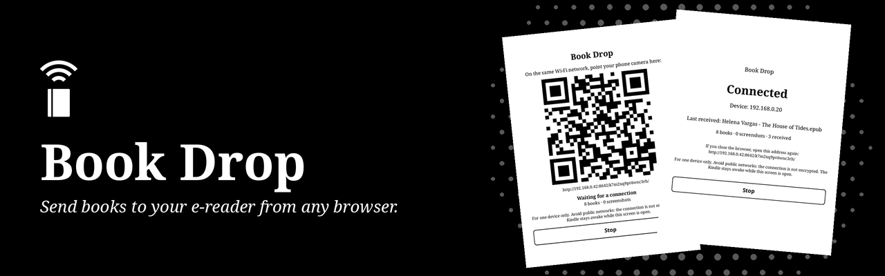
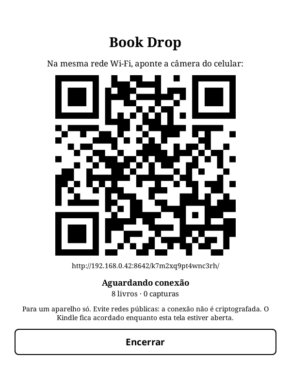
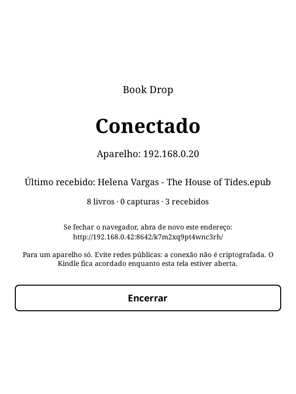

<p align="center">
  
</p>

<p align="center">
  <strong>Envie livros para o KOReader e baixe livros e capturas de tela por qualquer navegador, pela sua rede Wi-Fi local.<br>Sem instalar nada no outro aparelho.</strong>
</p>

<p align="center">
  <a href="#como-funciona">Como funciona</a> ·
  <a href="#instalação">Instalação</a> ·
  <a href="#segurança">Segurança</a> ·
  <a href="#compatibilidade">Compatibilidade</a> ·
  <a href="#desenvolvimento">Desenvolvimento</a> ·
  <a href="README.md">Read in English</a>
</p>

## Como funciona

<table>
  <tr>
    <td width="50%" align="center"><br><sub><b>Aponte o celular para o código</b></sub></td>
    <td width="50%" align="center"><br><sub><b>Veja quem está conectado e o que chegou</b></sub></td>
  </tr>
</table>

1. No menu Ferramentas, abra o **Book Drop**. O aparelho precisa estar no Wi-Fi.
2. Na mesma rede, aponte a câmera do celular para o QR code ou digite o endereço em qualquer navegador.
3. Toque em **Permitir** no leitor.
4. Use o navegador:
   - **Enviar:** escolha um ou mais livros e acompanhe o progresso de cada um.
   - **Livros:** baixe da sua pasta de livros, em grade com capas ou em lista.
   - **Capturas:** baixe uma a uma ou todas em `.zip`.
5. Toque em **Encerrar**. Os livros novos aparecem na sua biblioteca.

O aparelho fica acordado enquanto a tela estiver aberta, para a transferência não ser interrompida, e a tela encerra sozinha depois de 10 minutos sem uso.

Formatos aceitos: EPUB, PDF, MOBI, AZW, AZW3, PRC, FB2, DJVU, CBZ, TXT e RTF, com até 500 MB cada. Um arquivo com o mesmo nome nunca é substituído.

## Instalação

1. Baixe o `book_drop.koplugin.zip` da [última release](https://github.com/davydmaker/book_drop.koplugin/releases/latest).
2. Extraia em `koreader/plugins/`, de forma que exista `koreader/plugins/book_drop.koplugin/main.lua`.
3. Reinicie o KOReader. O plugin fica no menu Ferramentas, como **Book Drop**.

O idioma segue o do KOReader, no aparelho e no navegador: português, inglês ou espanhol. Em qualquer outro idioma, usa inglês.

## Segurança

> [!WARNING]
> A conexão usa HTTP simples, porque um servidor local não tem certificado para oferecer. Alguém capturando o tráfego da mesma rede poderia ver os arquivos. Use o Wi-Fi de casa ou o hotspot do celular, não redes públicas.

<details>
<summary><b>O que protege o seu aparelho</b></summary>

<br>

- **Ligado só durante o uso.** O servidor existe enquanto a tela está aberta e para ao encerrar, ao dormir e depois de 10 minutos sem uso.
- **Um código no endereço**, aleatório e novo a cada vez. Sem ele, toda resposta é o mesmo "não encontrado".
- **Permissão no aparelho.** O primeiro aparelho com o código precisa do seu toque, e depois disso nenhum outro endereço é atendido.
- **Só redes privadas.** Recusa iniciar fora de 10.x, 172.16-31.x e 192.168.x, e recusa clientes de fora.
- **Envios vão para um só lugar.** Só formatos de livro, sempre na sua pasta de livros. O nome não escolhe pasta nem cria arquivo oculto, e o arquivo só ganha o nome final depois de chegar inteiro.
- **Downloads vêm de uma lista.** Os arquivos são pedidos por um número em uma lista montada pelo servidor, então não há caminho para manipular. Atalhos não são seguidos, e os dados do KOReader ficam de fora.
- **Livros são tratados como não confiáveis.** As capas são lidas dos EPUBs com limites de tamanho e quantidade, e só são servidas quando o conteúdo é mesmo uma imagem.

A lista completa está em [docs/design.md](docs/design.md), em inglês.

</details>

## Compatibilidade

- Testado com o KOReader 2026.07 em um Kindle básico da 10ª geração (firmware 5.18.1).
- O servidor e as regras também rodam no KOReader de desktop, onde os testes são feitos. Manter o aparelho acordado e abrir o firewall foram escritos para Kindle; em outros aparelhos, confira as suas configurações de sono e de firewall.
- Redes com isolamento de clientes, comuns em Wi-Fi de visitantes, impedem o celular de alcançar o aparelho.
- Sempre na vertical. Se for aberto na horizontal, gira a tela e restaura a rotação ao sair.

## Desenvolvimento

Com o [LuaJIT](https://luajit.org) e o [LuaFileSystem](https://lunarmodules.github.io/luafilesystem/) instalados, a partir da raiz do repositório:

```sh
for spec in tests/*_spec.lua; do luajit "$spec"; done
```

Com `KOREADER_DIR` apontando para um KOReader de desktop, `tools/koreader/check_server.sh` sobe o servidor real e testa com `curl`. Está tudo descrito em [docs/design.md](docs/design.md). Contribuições são aceitas sob as licenças do projeto.

## Licença

Este projeto tem duas licenças. Veja o [NOTICE](NOTICE).

- **Código:** [GPL-3.0](LICENSE), somente a versão 3. Você pode usar, estudar, modificar e redistribuir, mantendo aberto sob a mesma licença.
- **Artes e textos:** [CC BY-NC-SA 4.0](LICENSE-CONTENT). Você pode compartilhar e adaptar, com crédito e sob a mesma licença, para fins não comerciais.

Estas licenças não concedem direitos sobre os nomes "Book Drop" e "Davyd Maker". Para outros usos, fale com [Davyd Maker](https://davydmaker.com).
